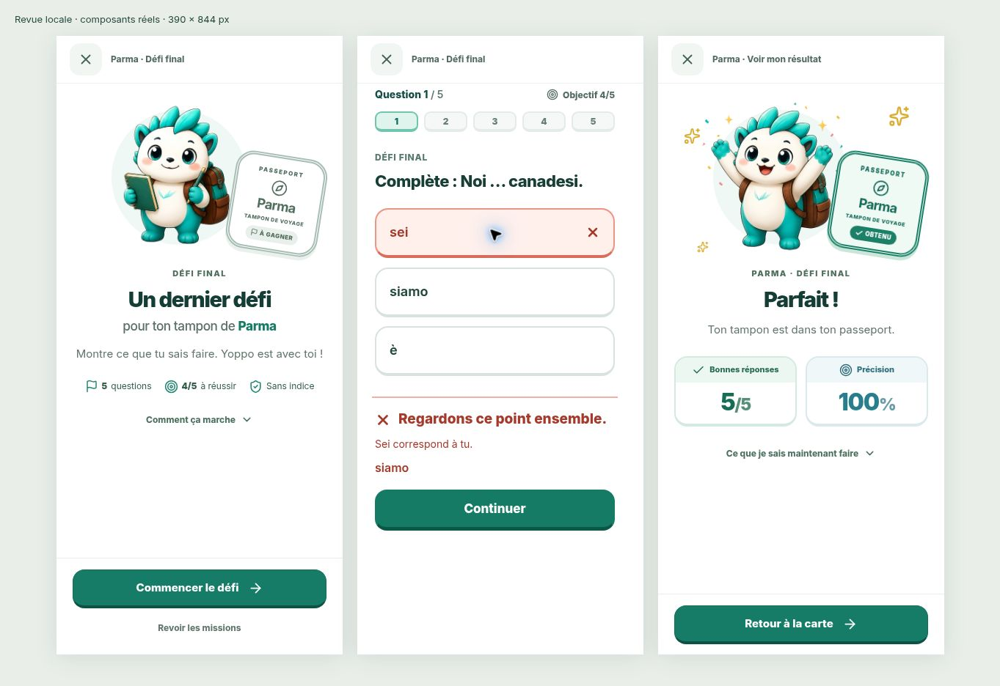

# YoPratiqo visual polish

## Direction · November 27, 2026

The founder supplied the current Parma final-challenge entry and result alongside
Duolingo pairing feedback and a perfect-result screen. The immediate issue is
visual hierarchy: nested containers, a repeated small mascot, an oversized castle
panel, long instructions and the main action below the fold.

Keep Pratiqo’s teal palette, Yoppo and the Italian travel/passport identity. Use a
single focused canvas, large readable instructions, touchable controls and clear
feedback. References inform craft, not a copy of Duolingo’s character or branding.

This is a visual workstream alongside the [active product roadmap](yopratiqo-overnight-roadmap.md).
It does not replace the privacy, evidence or adaptive-curriculum priorities.

## Pass 1 · Italian final challenges

Implemented across the shared Italian player, so all twelve units receive the
same presentation with their own city, questions and configured pass threshold.

- Entry: one large approved Yoppo asset with a destination passport stamp;
  compact question count, target and assistance rule; detailed rules in a disclosure.
- Questions: compact numbered progress, consistent choice and word tiles, visible
  selected/correct/incorrect states, icons as well as color, contextual audio and
  feedback. The next question resets the actual inner scroll container.
- Result: large celebration only after current independent success and a recorded
  earned stamp; real answer count and accuracy; objective/report details on demand.
- Retry: supportive wording and a direct retry action. Assistance remains explicit.
  A stamp from an earlier independent success stays visibly earned after a failed
  or assisted retry.
- Layout: full viewport on phones, contained dialog on larger screens; persistent
  primary action for entry/results; safe-area padding, height-aware illustration,
  visible focus and reduced-motion support.

No changes to grading, first-answer rules, assistance, progress persistence or
the pass threshold. No new XP award, countdown metric, paid gate or fabricated
learner profile. The remaining ordinary lesson presentation is unchanged.

### Visual review

The capture shows isolated review states of the real components, not one learner's
continuous attempt or a live account.

Review actual production components in the ignored backend-free review shell;
keep review state in its own namespace. Check phone 390 × 844, small phone
320 × 667, and landscape tablet 1024 × 768. Inspect entry, questions, error,
success, assisted result and retry. Verify that the primary action remains
reachable and that long content scrolls without horizontal clipping.

The reviewed viewport sizes are layout checks, not a claim of physical-device
coverage. Existing assertions that named the replaced markup/copy are aligned;
no new automated suite is required for this visual pass.

## Screen-by-screen sequence

| Order | Surface | Completion criterion |
| --- | --- | --- |
| 1 | Italian final challenge: entry, questions, results | Clear hierarchy and truthful result in each outcome; visible main action on mobile and tablet |
| 2 | Ordinary exercises: pairing, listening, word order, choice | One consistent family of tiles and feedback; obvious audio and interaction states; parity across shared engines |
| 3 | Mission introduction and completion | One prominent Yoppo, short goal, visible start/continue action; media and transcript controls readable |
| 4 | Journey map and city selection | Clear current position, destination and next action at every screen size |
| 5 | Passport and collected objects | Distinct, legible collected/available/locked states; only earned rewards shown as collected |
| 6 | XP, rankings and friends | Strong hierarchy for real totals and positions; clear loading and empty states; no invented people |
| 7 | Onboarding and interest choices | Consistent cards, typography, spacing and selection states; immediate understandable personalization |
| 8 | Notebook, reviews and progress | Clear due/learned distinctions, easy retrieval, coherent shared controls |

For every surface, review normal, loading, empty, error, success and long-content
states where they exist. Finish a complete interaction before moving to the next.

## Design references

- [Duolingo’s core-tab redesign](https://blog.duolingo.com/core-tabs-redesign/):
  consistency, spacing, typography and removing unnecessary containers.
- [Duolingo’s illustration shape language](https://blog.duolingo.com/shape-language-duolingos-art-style/):
  readable forms, deliberate composition and movement that guides attention.
