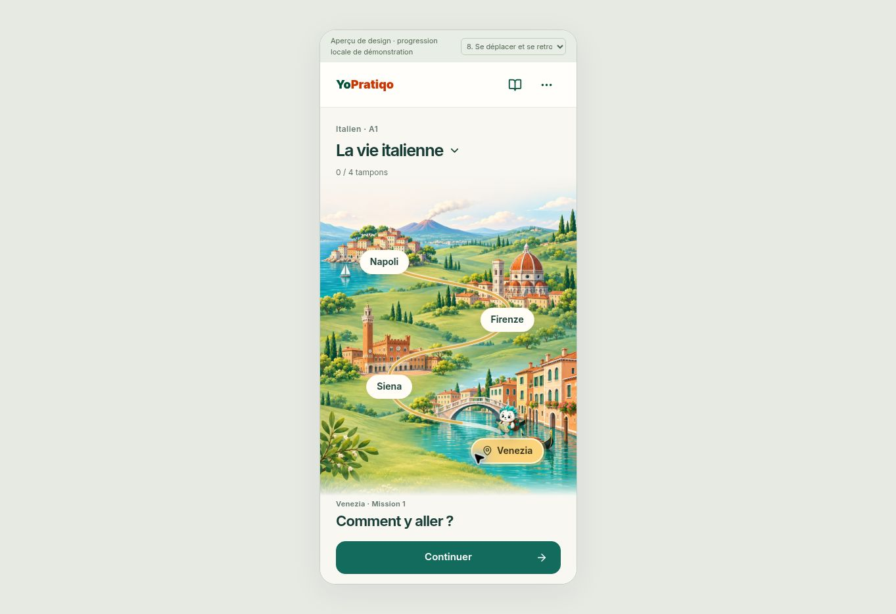
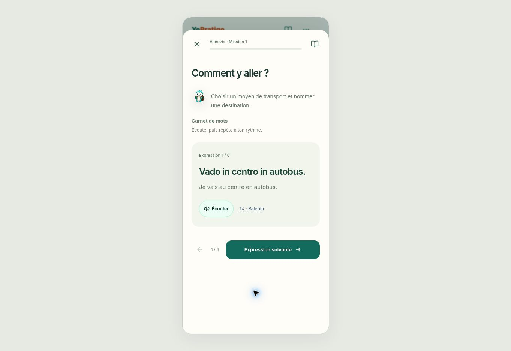

# Italian map and mission design review

Replaces the framed board and repeated Play controls with three illustrated landscapes, accessible city markers, a compact world selector, and one primary Continue action. Uses the existing official Yoppo assets. Desktop places the current mission beside the map. Mobile retains the portrait artwork.

Missions use a 96dvh mobile / 92dvh desktop dialog, compact progress header, simpler answer cards and one vocabulary expression at a time. Previous/next study navigation retains its cursor across leaving and resuming. The cursor is presentation state only. Canonical activities, assessment scoring, assisted attempts, stamps, access rules and course identifiers remain unchanged.

Printables are available through the tools menu and mission briefing. The complete vocabulary bank remains accessible.

## Verification

- `npm run test:yo-italian-course` passed.
- `npm run test:yo-italian-pilot` passed.
- Map-first mission interactions passed, including close/resume, study cursor, no invented mastery and printable access.
- Adventure map, desktop/printables, immersive phase 3 and city identity suites passed, including locked links and authentic unlocks.
- `git diff --check` passed.
- Browser QA at 390×844 and desktop: map, mission opening/resuming, vocabulary navigation, audio control/playback state, transition through original lesson stages and matching feedback.
- `tsc --noEmit --incremental false` is blocked by the existing error at `tests/cafe/cafeArchitectureContract.test.ts:62` (`reason` on `never`). The same error is reproduced in an unchanged worktree at base `9a3f6764d2371995e1e8701694fe8e85c3a5d112`. No design-file TypeScript error remains.
- A physical iPhone/Safari check and the full production build remain before merge. No production deployment or Rive/reference edits.

## Review build

`node tools/italian-design-review/build.mjs /absolute/review/dist`

The static review bundles the actual course components with small Next link/image adapters. It has a city chooser for review and uses an isolated browser origin for local demonstration progress. Choosing a later city uses the existing placement/review permission; it does not award stamps. The product routes continue to use real Next components and the existing onboarding.

The generated travel illustrations are decorative, geographically condensed scenes rather than literal maps. All labels, controls, status and the progress route are live DOM/SVG. Optimized images total approximately 924 KB.

## Follow-up: city selection, motion and atmosphere

City buttons now inspect a destination without navigation, opening a lesson, changing saved progress or relocating Yoppo. Continue explicitly navigates. Yoppo is anchored to canonical progression or the placement start, independent of the inspected city. A keyed course instance prevents one city's UI draft leaking into another.

Yoppo's map marker follows sampled road curves when earned progression changes its destination. Motion waits until the map is visible and respects reduced motion. This is map-marker travel, not a rigged character walk cycle.

The speaker switch opts into quiet procedural breeze/water ambience. It is silent during lessons, tools, recorded playback and hidden-page states; its engine closes on unmount. Feedback settings now also work in the standalone review, including existing optional haptics. Actual vibration depends on hardware/browser support and has not been verified on an iPhone.

City-selection regression checks, route geometry and audio lifecycle checks cover this follow-up. Browser review verified selecting Firenze while Yoppo remains at Venezia, explicit Continue navigation, and the ambience/feedback controls.

### Animated story sample

One eight-second 16:9 animated taxi scene was submitted to HeyGen Video 1 using the official Yoppo idle PNG as the identity reference. Generation ID: `1df6f85ed3654a5d8b7d8fc9032a59dc`. The inline player tracks its status. The result has not been visually reviewed or integrated into the app.

The intended actions are walking to the taxi, waving, boarding and driving away. Intended learning phrase: **Alla stazione, per favore.** / **À la gare, s'il vous plaît.** Phrase/audio should be accessible DOM content beside the finished clip rather than generated lettering. Playback must be skippable, non-looping and optional with reduced motion; it cannot award progress or block a lesson on media failure.

Next story contexts: train departure (*Un biglietto per Firenze, per favore*), airport transition (*Dov'è l'uscita?*), greeting a new person (*Piacere, come ti chiami?*). These are planned scenes, not generated or shipped assets.
