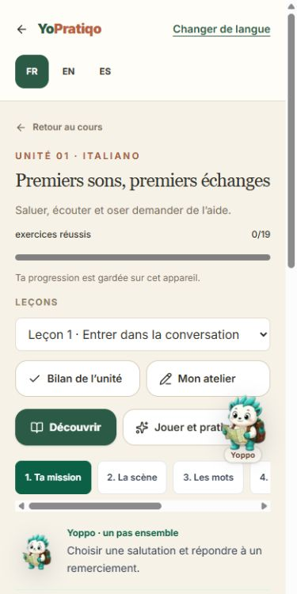
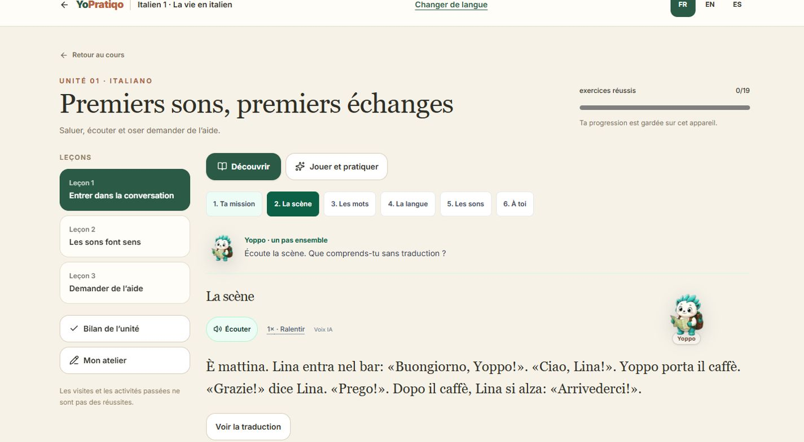
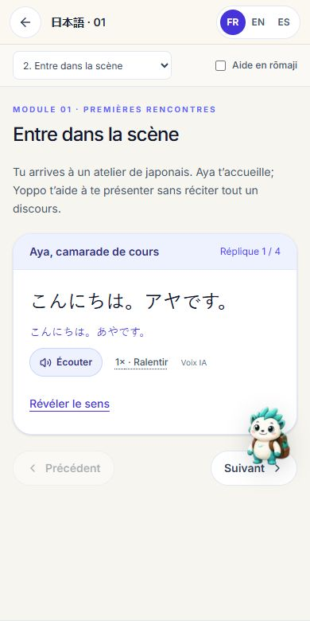
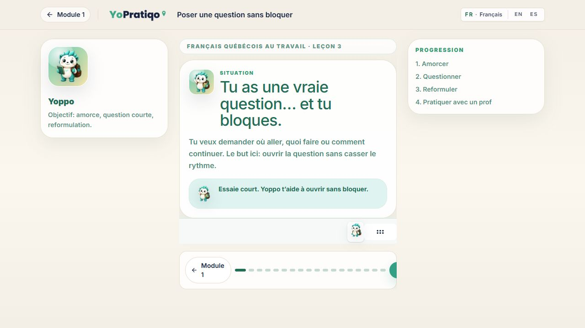
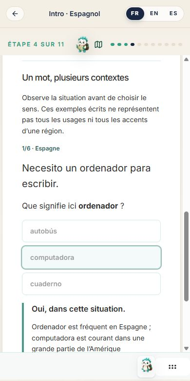
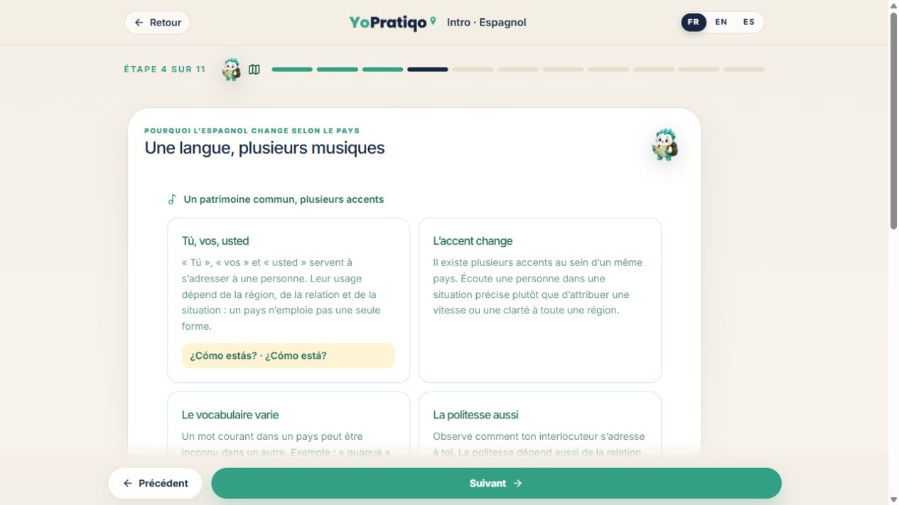
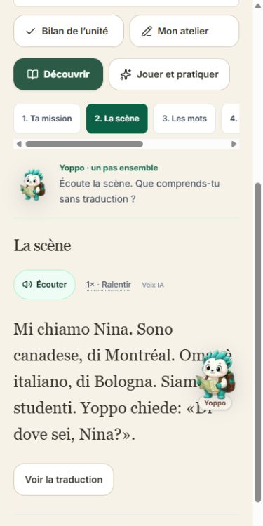

# Course quality unification — working specification

## Release authorization update - 2026-11-05

The user subsequently authorized deployment of the validated web increment.
The earlier draft-only/publication restrictions below describe the previous
review stage, not the current authorization. Passes, credits, gifts, native-store
submission and account-sync work are still outside this release.

All 28 reviewed-cache Italian audio objects have now been published to the
existing Pratiqo `yopratiqo-audio` bucket with `upsert: false`: 28 cache hits,
28 uploads and 28 public MP3/hash verifications, zero failures, zero generation.
No working recording was overwritten. A fresh complete 905-path public audit is
required before merge. The local-only build artifacts are not promoted; Git/Vercel
must rebuild the final commit using the project's Production environment.

Human pronunciation certification and physical-device QA are not claimed. See
`YOPPO_ADVENTURE_REVIEW.md` for the subsequently validated adventure presentation.
The previous production rollback candidate is Vercel deployment
`8CvuRrEyuw4ztF1QtQjc3ZSq396W`, commit
`d8a6eaa03086b519f46256067cc4fe0f9c93877f`. Application rollback preserves the
existing and newly added recordings and all progress; no migration is needed.

## Product decision

Japanese is the quality reference. Match its coherent lesson flow, language-specific
practice, useful feedback and dependable media. Sharing a mascot alone does not
establish pedagogical or visual parity. Italian requires a substantive editorial
and interaction review; beginner language should still feel purposeful and mature.

Prioritize course quality before passes, paid checkpoints or advanced-level sales.
Existing purchases, routes and progress identifiers must survive any migration.
Do not assume each existing course contains eight modules: the current Italian
foundation course has twelve units. Commercial stages need an explicit curriculum
mapping before they can be priced.

## Shared experience

All eight language journeys should provide:

- A practical objective and a credible illustrated scene.
- An understandable dialogue before isolated vocabulary and grammar.
- A word notebook with hideable translations and optional recall practice.
- Working audio with slower playback, retry and accurate transcript alignment.
- Varied listening, reading, sentence-building and contextual choice activities.
- Feedback explaining both success and plausible mistakes.
- Practical speaking/writing tasks, clearly distinguished from machine-checked work.
- A midpoint recap that reviews earlier material and a final transfer task.
- Yoppo help, optional trivia breaks and an exact return to the learner's work.
- Consistent mobile navigation, keyboard access and reduced-motion behavior.

Yoppo's trivia scores must never mark language activities as mastered. Help that
reveals an answer must be tracked as assisted. General strategy hints reveal no
answers. Existing local progress must not be relabeled as account-synced progress.

## Spanish direction

Spanish is one language journey, with regional voices and cultural encounters
inside its modules. Do not ask learners to choose a country as the primary course.
Keep the Dominican material and its purchased access as an existing cultural
immersion, not as a generic course simply renamed to imply broader coverage.

Future authored modules should incorporate Spain, Mexico, the Caribbean, Central
America, the Andes and the Río de la Plata, with more than one community or voice
where relevant. Avoid equating a country with a single accent. Pair common
communicative goals with contextual vocabulary and pronunciation comparisons.
Regional recordings need verified voice provenance and pronunciation review;
changing a label or browser voice locale does not create authentic regional audio.

## Initial draft (historical, before this follow-up)

- Shared Yoppo companion connected to the legacy lesson deck (including French
  and Spanish introductions and existing deck-based lessons).
- A compact companion dock preserves room for the lesson; modal keyboard input
  does not navigate the underlying lesson. Opening breaks stops shared audio.
- Shared audio errors offer retry, hidden-page playback stops, and metadata is
  not prefetched for every hidden lesson recording.
- Italian study stages present the scene before vocabulary, grammar and sounds.
  The vocabulary notebook is the default; recall cards remain optional.
- Spanish landing/intro copy moves from country selection toward cultural
  encounters, explicitly marking broader content as still in preparation.

## Initial open items (historical; current evidence follows)

- Full browser QA of the changed layouts on phone and desktop.
- Complete project build/typecheck/lint and regression suites in a full checkout.
- Reproduce the user's failing Italian audio interaction in a real browser:
  successful public file delivery alone does not validate playback or pronunciation.
- Review Italian lesson scripts, challenge variety, feedback and information density
  against Japanese; the first study-flow improvements are not a complete redesign.
- Extend context-aware companion integration to remaining non-deck French and
  Spanish lesson surfaces without creating duplicate companions.
- Author and review the broader Spanish curriculum and regional audio; update
  catalog metadata/SEO only to reflect what is actually available.
- Bring every language through the same quality checklist before adding passes.

Production deployment and pricing changes are outside this draft.

## Follow-up review: PR 429

Base: `d8a6eaa03086b519f46256067cc4fe0f9c93877f`. Reviewed initial draft:
`6e26c6d97e1317554005587897db3b31399db829`. Work is isolated in
`yo-course-quality` on `codex/yo-course-quality-foundation`.

### Parity matrix: implemented content, not promised levels

| Language | Actual curriculum / navigation | Companion, practice and feedback | Audio and culture | Progress / access / remaining gap |
| --- | --- | --- | --- | --- |
| Japanese (reference) | 8 foundation modules; kana, kanji in context, dialogues and final checkpoint | Dedicated player, contextual Yoppo, writing/recognition/listening, assisted vs independent checkpoints | Recorded audio, visual context, script-specific explanations | Existing foundation journey and local progress remain intact; no new purchase gate |
| Italian | 12 units, 36 lessons, unit checkpoints, cumulative assessments and cultural finale; intro and Bologna remain separate entry points | Shared study sequence now mission, scene, notebook, language, sounds, production; optional recall; listening, dictation, pairing, ordering, writing, unit project; Yoppo help/trivia | 905 distinct referenced recordings across intro/Bologna/foundations; 28 locally repaired/new; photo encounters and cultural finale | Stable `yopratiqo:italian-course:a1:v1` and all activity IDs preserved; tab drafts retained without storing private prose. Full editorial parity is not established by these changes alone |
| French / Quebec | Free introduction; workplace module-1 remains a planned 7-lesson shell, with lesson 1/2 previews and substantive lesson-3 page | Deck companion plus opt-in non-deck companion on lesson 3; contextual shell help; exercises remain mounted while navigating or taking a break | Existing Quebec recordings and workplace examples retained | Existing exploration/local state and disabled premium flags unchanged; unfinished lessons are not advertised as completed |
| Spanish | Common introduction plus existing Dominican sequence (intro and modules 2-5), with legacy country URLs retained | Shared deck companion on live module routes; six new written regional-context questions with explanations and retry | Existing Dominican recordings unchanged; sourced Spain/Mexico/Caribbean/Guatemala/Ecuador/Argentina contexts, not an invented regional voice collection | No redirect, entitlement or progress-key changes. Broader regional curriculum and reviewed sound comparisons still need authoring |
| English | Existing beginner introduction, not an invented 8-module course | Shared deck: phrases, false friends, listening, speaking and companion breaks | Existing Canadian context and audio retained | Exploration journey remains separate from mastery; higher-level curriculum is not implemented |
| German | 8 units, 24 lessons, language checkpoint and cultural finale | Shared course activity engine, language-specific grammar/pronunciation, contextual Yoppo and independent scoring | Existing bundled recordings and photo stops retained | Existing namespace and gates retained; no claim that every German screen was re-reviewed visually in this follow-up |
| Brazilian Portuguese | 8 units, 24 lessons, language checkpoint and cultural finale | Shared activity engine, Brazilian language content, useful games, production and Yoppo | Existing Brazilian recordings/photos retained; not relabelled European Portuguese | Existing progress namespace retained; complete linguistic review is separate |
| Mandarin | 8 modules plus final mission; tones, pinyin and simplified characters | Dedicated player and tone-specific exercises; existing Yoppo and mastery rules | Existing recorded audio and cultural context retained | `yopratiqo:mandarin-foundations:v1` preserved; no imposed Italian lesson structure |

Sources inspected: `publicCatalog.ts`, `yopratiqoProductConfig.ts`,
`foundationJourneyCatalogs.ts`, Italian/German/Portuguese course catalogs and
progress modules, Mandarin progress, actual French/Spanish route renderers and
the existing course/player tests. Interface locale support is not uniform:
foundation players support FR/EN/ES; some older introductory/workplace copy is
FR/EN or French-only. The shared companion is translated in all three locales,
which does not magically translate the older lesson content.

Legacy `futurePremiumModules` still has public-launch/checkout disabled. Dominican
routes still use their existing renderers. This PR changes neither purchased
access, Stripe, authentication, product configuration nor any database schema.

### Corrections in this follow-up

- Audio starts cancel other shared, Italian, Japanese and speech playback through
  one small stop helper. A stale `playing` event cannot restart cancelled media.
  Hidden mounted panels and document visibility changes stop playback.
- Italian's notebook, recall queue, speaking checkboxes and unfinished writing
  stay mounted/in memory across study stages, lesson selection and practice.
  Reset generation still deliberately resets them. Refresh persistence is not
  promised for private text; scored progress keeps its existing storage format.
- The first two Italian reading scenes now have a purpose: ordering/receiving a
  coffee, thanking someone, leaving; then choosing different menu items. Text,
  translations, affected feedback and content-hashed recording paths changed
  together. The remaining lessons inherit the same improved interaction shell.
- Non-deck French lesson 3 now uses the shared companion, with dialog keyboard
  isolation. The workplace shell adds strategy/example help without making its
  unfinished lessons purchasable. Deck quiz help never reveals helper answers.
- Arrow keys on the companion controls no longer advance the non-deck lesson.
  The regression test opens the actual help panel before checking answer privacy.
- Italian mobile lesson selection is now one native selector rather than a wide
  row of cards. Smaller mobile headings and a single scrollable study-stage row
  keep more space for the actual activity; desktop lesson navigation is retained.
- Spanish starts with broadly useful language. Its optional regional practice
  records no mastery and makes no accent claims. Current country routes/bookmarks
  still work; no historical Dominican content is silently renamed.
- Actual browser QA also found that the Quebec introduction defaults to English
  but its FR selector linked to the bare route. That selector now uses explicit
  `?lang=fr` and disables ES for this FR/EN-only page. Both header variants are
  covered by rendered tests; the page's default and canonical policy are unchanged.
- The older Spanish accent/register copy no longer assigns one speed, clarity
  or form of address to a whole country. Existing quiz IDs and correct-answer IDs
  stay unchanged; regional context and the option to ask for clarification replace
  the unsupported generalizations.

### Regional evidence

The six scenes contrast context, not national stereotypes. Sources:
[computador](https://www.rae.es/dpd/computador),
[camion](https://dle.rae.es/cami%C3%B3n),
[guagua](https://dle.rae.es/guagua),
[colectivo](https://dle.rae.es/colectivo) (RAE/ASALE).
In particular, `guagua` can mean a bus or a baby depending on context/region.
No generic synthetic recording is presented as a native regional recording.

### Audio evidence and release ordering

The initial JSON audit above remains historical. A fresh read-only public GET
audit found 877/905 current unique paths present and 28 absent: the known 26
Bologna files and two newly authored reading paths. All existing bytes were
reused unchanged. The established generator (`gpt-4o-mini-tts`, `alloy`) created
only those 28 and uploaded them **only to the isolated local Supabase storage**.
All 28 passed the existing MIME/MP3/frame/duration/hash validation.

The browser subsequently fetched and decoded **905/905** local MP3s with Web
Audio, zero decode failures, approximately 2,662 seconds of audio. This is actual
decoding, not merely HTTP 200. It does not certify accent or naturalness.
The user authorized up to USD 20; generation was restricted to 28 clips and at
most 6,000 input characters. No billing-total claim is made without a usage bill.

Local evidence and cache are outside Git in `../yo-course-quality-preview/`:
`audio-audit.json`, `audio-cache/`, and the audio-check page. No service key,
environment file, recording or local backend configuration is committed.

**Do not merge this content update before reviewing and publishing the 28
approved recordings to the intended storage via the existing generator/cache
workflow.** The public site was not repaired by the local upload. Publish only
missing approved paths with `upsert: false`; never overwrite working files.
Then verify the public paths before shipping their new manifest references.
Rollback is an application revert; keep old recordings, progress keys and access
configuration. No data migration is necessary.

### Validation evidence

Logs are retained outside Git in `../yo-course-quality-preview/`; the runner's
`validation.json` retains failures as well as subsequent successful runs.

| Command | Actual result |
| --- | --- |
| `npm run test:yo-journey` | PASS, 14 cases |
| `npm run test:yo-audio` | PASS |
| `npm run test:yo-audio-pronunciation` | PASS (manifest/override checks, not human listening review) |
| `npm run test:yo-italian-audio` | PASS |
| `npm run test:yo-italian-course` | PASS after intended scene-order assertions were updated |
| `npm run test:yo-italian-module` | PASS |
| `npm run test:yo-italian-recorded-audio` | PASS; `recorded-audio-rerun.log`, including 19 player cases |
| `npm run test:yo-mandarin` | PASS |
| `npm run test:yo-german` | PASS |
| `npm run test:yo-portuguese` | PASS |
| `npm run test:launch-critical` | PASS; includes Japanese, French, Dominican, SEO and marketplace guards |
| `npm run lint` | PASS; final selector/content edits checked separately below |
| `npx tsc --noEmit` | PASS again after the final selector/content correction |
| `npx tsx scripts/validate_i18n.ts` | PASS, 3,562 keys per locale |
| `node --import tsx tests/yo/yopratiqoSharedCompanionAudio.test.tsx` | PASS, 14 rendered cases after final selector correction |
| `npx tsx tests/yo/yopratiqoSeoCatalog.test.ts` | PASS, eight-language catalog/metadata/links/access invariants |
| `node ../yo-course-quality-preview/app.cjs build` | PASS on final app code; Next 16.2.9, compilation, full TypeScript and 353 generated pages |
| `git diff --check` | PASS before final report update; rechecked before commit |

After the last selector/content edits, these affected checks also passed:
`node --import tsx tests/legal/safeDisclosures.test.ts` (10),
`node --import tsx tests/yo/yopratiqoAppHeaderLanguageSelector.test.ts` (10),
`node --import tsx tests/yo/yopratiqoSpanishAudioCoverage.test.ts` (25), and
`npx eslint components/yo/YoLanguageSelector.tsx lib/yo/spanishIntroA1.ts tests/helpers/italianLearningScope.ts tests/yo/yopratiqoSharedCompanionAudio.test.tsx`.
The full launch-critical run passed before that final localized selector/copy
correction; these focused checks, final full typecheck and build cover its delta.
Existing warnings remain: stale Browserslist data and Turbopack ignoring the
existing `experimental.forceSwcTransforms` option. No check was disabled.

Initial failures were not hidden: three Italian player assertions expected
grammar at step 3; they now explicitly verify scene step 2 and grammar step 4.
The recorded-audio guard rejected a browser speech-synthesis call in the shared
stop helper; it was removed in favor of the existing cancellation event.
The legal scope guard initially rejected the new teaching-only sources. Its
explicit reviewed file list was extended; AST checks still reject privileged
imports, API calls and secrets. Existing negative guard tests remain active.
The aggregate `test:yo-italian` was not repeated after its initial failure;
the successful constituent commands above are the evidence, not a claimed
aggregate pass.

### Remaining product review

Keep this PR draft pending the real learner review. Human Italian pronunciation
review, deeper editorial review of all 36 lessons, authored Spanish regional
modules and reviewed regional audio are not replaced by automated checks. Future
levels remain an architectural direction, not newly shipped curriculum. No
passes, referral incentives, prices, checkout changes or paid gates were added.

### Local learner review

The production-mode local app uses the existing isolated Supabase stack, through
`http://127.0.0.1:55680`; its configuration and audio cache are outside Git. It has
no production environment file. Review these routes without an account:

- `/yo/langues/italien/parcours/u01?lang=fr`: changed first unit.
- `/yo/langues/italien/module-1?lang=fr`: existing Bologna workshop.
- `/yo/langues/japonais/parcours/module-1`: reference player.
- `/yo/langues/francais-quebec/intro`: deck-based French introduction.
- `/yo/langues/francais-quebec/module-1/lecon-3`: non-deck French lesson.
- `/yo/langues/espagnol/intro`: common foundations and optional written regional practice.
- `/audio-check.html`: 28 local recordings with transcripts for listening review;
  the optional decode button checks all 905 files again.

Actual browser evidence: Italian unit 1 and Japanese module 1 were inspected at
desktop and 390 x 844 mobile dimensions. Italian normal/slow playback starts,
navigation stops it, and the writing draft/checks survive lesson selection and
return. Italian page width was 375 CSS pixels, with scrollWidth also 375: no
page-level horizontal overflow. The compact selector is visible in the final
mobile capture. One interactive Yoppo appears; decorative lesson illustrations
are not extra interactive companions.

After closing stale QA tabs, the real French lesson and Spanish introduction
loaded correctly. French lesson 3 was checked on desktop and at 390 x 844:
contextual help, trivia feedback and return to step 3 preserved the selected
answer and visible feedback within a stable viewport. The French introduction's
deck navigation was also exercised; this exposed the locale-selector correction
above. The separate mobile/desktop French renderers reset when crossing their
breakpoint, an existing limitation: no cross-breakpoint draft-resume claim is made.
Spanish's first four steps and regional practice were exercised on mobile:
answer, feedback/source, next example and previous example retain the answer.
No console errors were captured on this French/Spanish QA tab.

Physical Safari, reduced-motion browser behavior and perceptual pronunciation
review remain unverified. Unit/component tests do not substitute for those checks.
The final production-build browser pass confirmed FR selection on the Quebec
intro now changes the actual content and metadata, preserving step 2. Spanish
desktop renders the corrected variation copy and regional activity.

The local Italian unit-1 checkpoint was completed through its five real UI
questions (including playback and written production), producing 5/5 and the
normal next-unit link. Unit 2 then opened without writing test state directly.
Its scene, recorded audio and compact mobile selector were inspected; scrollWidth
equals clientWidth (375 CSS pixels). No console errors were captured on this tab.
This is a local UI verification, not evidence of anyone's language proficiency.

The existing dedicated Italian floating companion can still sit over prose while
scrolling (visible in the unit-2 capture). It can be moved/minimized/hidden, but
its placement has not been redesigned into the new deck's reserved rail. Treat
this as a remaining mobile presentation issue, not a fully polished screen.
The French responsive renderer also needs a future shared-state approach to
retain in-memory answers when crossing desktop/mobile breakpoints.

Italian retains its existing dedicated Yoppo coach and bonus activity. The shared
three-question/active-time return invitation is exercised by the legacy decks,
non-deck French integration and existing Mandarin player; this does not claim
that Italian's older bonus interface was silently replaced by that shared policy.
